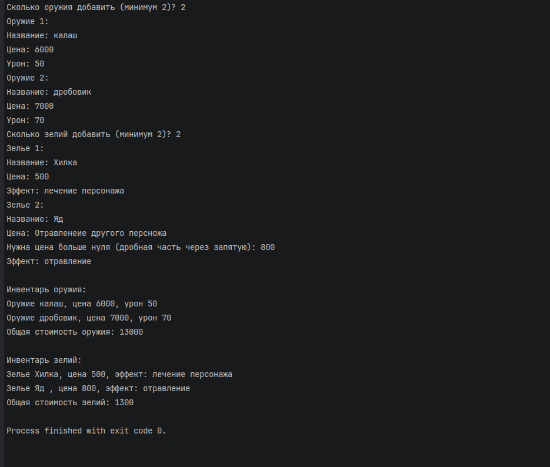

# КТ №24 — Ограниченные классы

**Вариант 2 — Инвентарь предметов**

- Абстрактный базовый класс `Item` со свойствами `string Name { get; init; }`, `decimal Value { get; init; }` и абстрактным методом `string GetDescription()`.
- Обобщённый класс `Inventory<T> where T : Item` с методами `Add(T item)`, `decimal GetTotalValue()` (сумма `Value` всех предметов) и `void PrintAll()` (выводит `GetDescription()` для каждого предмета).
- Производные классы `Weapon : Item` (переопределяет `GetDescription()`, добавляя урон) и `Potion : Item` (переопределяет `GetDescription()`, добавляя эффект).
- Созданы `Inventory<Weapon>` и `Inventory<Potion>`, в каждый добавляется минимум два предмета.
- Методы `Inventory<T>` используют `item.Value` и `item.GetDescription()` напрямую, без приведения типов, — работает ограничение `where T : Item`.

Все данные вводит пользователь; неверный ввод (не число, число не больше нуля, пустая строка) запрашивается повторно.

## Проверочные ключи

Оружие: калаш (цена `6000`, урон `50`), дробовик (цена `7000`, урон `70`). Зелья: Хилка (цена `500`, эффект «лечение персонажа»), Яд (цена `800`, эффект «отравление»).

| Действие | Ожидаемый результат |
|---|---|
| `Inventory<Weapon>.GetTotalValue()` | `Общая стоимость оружия: 13000` |
| `Inventory<Weapon>.PrintAll()` | `Оружие калаш, цена 6000, урон 50`, `Оружие дробовик, цена 7000, урон 70` |
| `Inventory<Potion>` с собственным набором данных | `Общая стоимость зелий: 1300` — работает независимо от `Inventory<Weapon>` |

## Запуск

```
dotnet run
```

## Результат выполнения


